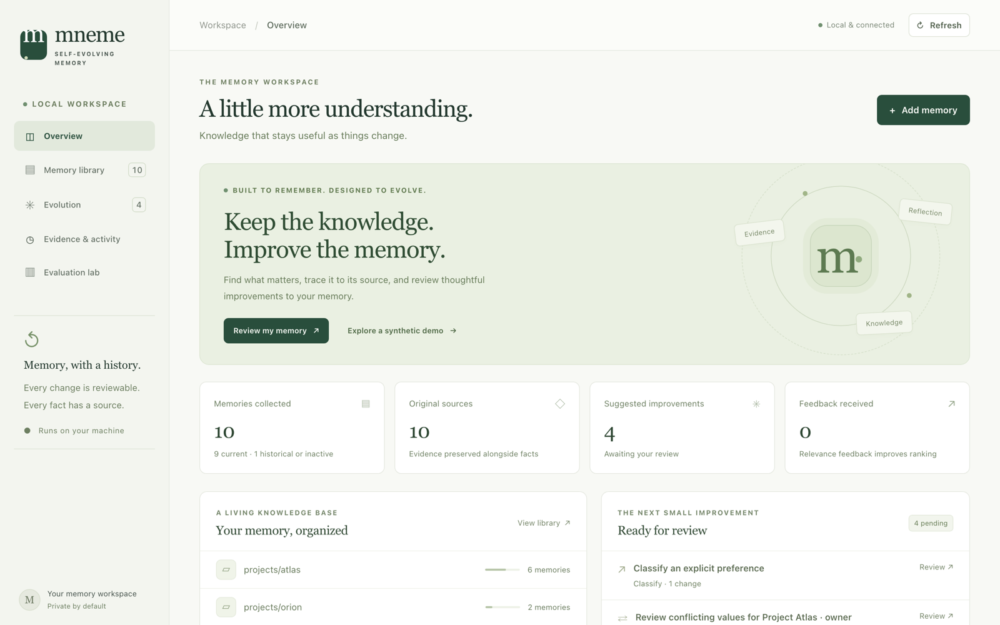
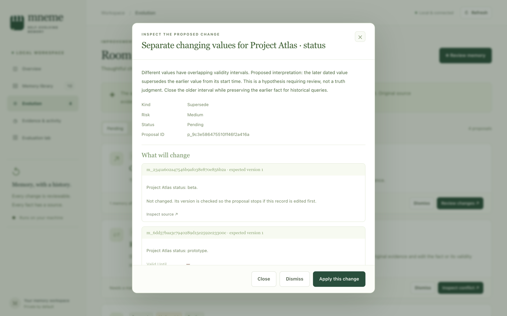
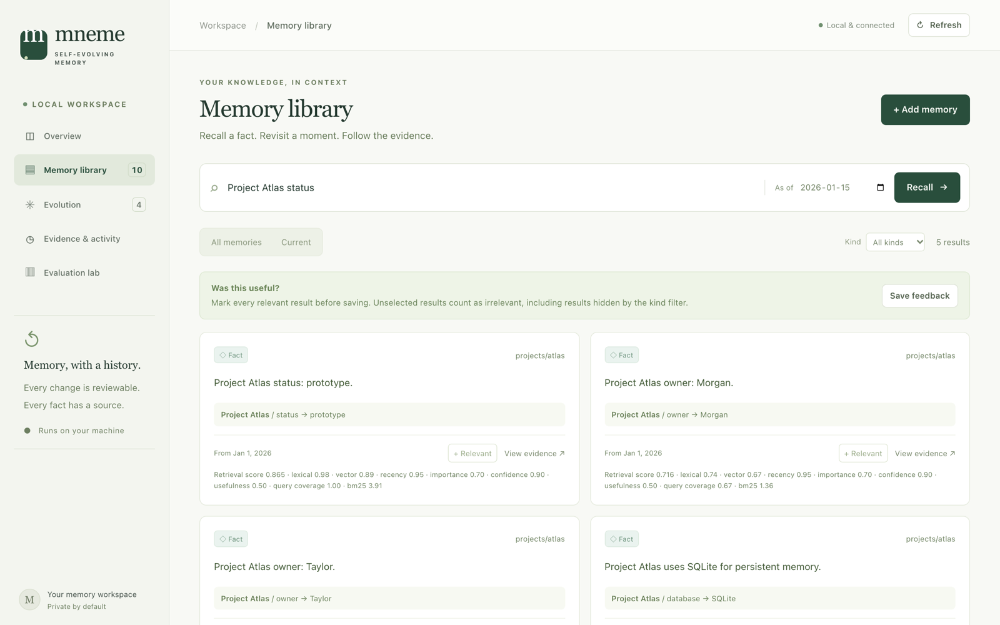
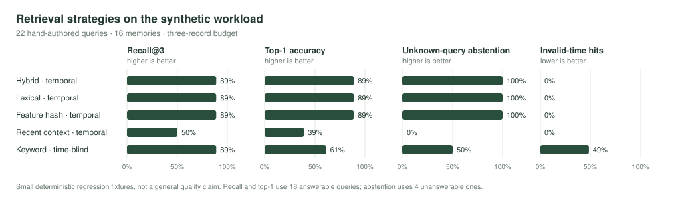

# Self-Evolving Memory Agent

**A local memory engine that proposes improvements, preserves evidence, and lets you undo its changes.**

The Mneme dashboard brings ingestion, historical retrieval, memory review, and evaluation into one place. Everything runs on Python's standard library: no API key, cloud service, model download, JavaScript build, or runtime dependency is required.



## Start in one command

Requires **Python 3.9+ with SQLite FTS5** (included in common Python distributions).

```bash
python3 run.py serve --demo
```

Open **http://127.0.0.1:8765**. The demo uses invented projects and people. It seeds only an empty collection and creates proposals for you to review.

To start with an empty collection instead:

```bash
python3 run.py --root .memory-agent/personal serve
```

Optional installation into your own virtual environment:

```bash
python3 -m venv .venv
source .venv/bin/activate
python -m pip install --upgrade pip   # editable installs need pip 21.3 or newer
python -m pip install -e .
memory-agent serve --demo
```

The source launcher works without that installation. Stop the server with Ctrl+C. Your memories remain on disk.

## What evolves

| Capability | Behavior |
| --- | --- |
| Duplicate consolidation | Proposes archiving exact duplicates, and repeats of the same open-ended note, preference or procedure, keeping the earliest. Every record and original source is retained. |
| Changing facts | Detects overlapping values for the same subject and predicate; proposes closing the older validity interval. |
| Unresolved contradictions | Flags conflicting values with the same start time for manual evidence review. It does not select a winner. |
| Interruptions | Flags a temporary value that ends while an earlier value is still open. Closing the earlier value would erase the period after the interruption, so a person decides. |
| Memory classification | Recognizes explicit enduring preferences and proposes changing their type without rewriting their wording. |
| Organization | Proposes splitting crowded, mixed-type topics into type subfolders. |
| Feedback learning | Learns a bounded relevance prior from your ratings of retrieved memories. |
| Periodic review | The server proposes improvements every five minutes; you decide which to apply. |
| Reversibility | Undo restores the previous semantic fields, provided no later edit would be overwritten. A later review may suggest the change again; dismiss it to keep the current state. |

This is **rule-based memory evolution with learned relevance**, not a self-modifying language model. The local vector baseline uses hashed word and character features, **not pretrained semantic embeddings**. The agent retrieves evidence; it does not fabricate a fluent answer around it.

## Try the review loop



1. Start the demo and open **Evolution**. Inspect the before/after values and source evidence.
2. Apply the duplicate proposal. The active record count falls; the original sources remain available.
3. Apply the changing-status proposal for Project Atlas. Search `Project Atlas status` with date `2026-01-15` to retrieve the prototype status, then `2026-02-15` to retrieve beta.
4. Inspect the conflicting Project Atlas owners. Both start on the same day, so the agent requests manual review. Edit a memory's value, dates, or archive status after inspecting the evidence, then review again: the resolved conflict is marked outdated and any follow-up proposal appears.
5. Undo an applied proposal. Its semantic changes are reversed and the audit trail records the reversal.
6. Search, mark all relevant results, and submit feedback. Unchecked results count as irrelevant; the learned ranking prior persists across restarts.



## CLI

Put `--root DIRECTORY` **before** the command when choosing a data directory.

```bash
# Add a dated structured fact.
python3 run.py add "Atlas is in prototype" --kind fact --topic projects/atlas \
  --subject Atlas --predicate status --value prototype --valid-from 2026-01-01

# Import a text file, retaining the complete source as evidence.
python3 run.py ingest examples/conversation.txt --topic projects/atlas

# Propose changes, then inspect and apply a chosen proposal ID.
python3 run.py review
python3 run.py proposals
python3 run.py apply p_REPLACE_WITH_REAL_ID
python3 run.py undo p_REPLACE_WITH_REAL_ID

# Retrieve only facts valid at the requested time.
python3 run.py search "Atlas status" --as-of 2026-01-15

# Inspect and manually correct a record with optimistic concurrency.
python3 run.py list --all
python3 run.py update m_REPLACE_WITH_REAL_ID --version 1 \
  --changes '{"valid_until":"2026-02-01"}'

# Periodic review without a dashboard; no edits are automatically applied.
python3 run.py watch --interval 300

# Inspect stats and refresh the generated Markdown view.
python3 run.py stats
python3 run.py export
```

Text import is deliberately conservative: one non-empty line becomes one memory, and the whole text is stored once as evidence for all of them. A line with exactly three non-empty `|`-separated parts, `subject | predicate | value`, becomes a structured fact; an optional `[YYYY-MM-DD]` prefix sets its start date, otherwise it starts at import time. List markers (`-`, `*`, `1.`) are removed. Explicit `I prefer…` statements become preferences; `Always…` / `Never…` statements become procedures. Other prose stays verbatim as a note. It does not infer entity relationships or dates from arbitrary conversation. Markdown headings (`# Title`) are skipped; text such as `#1 priority` is kept.

For the Python interface:

```python
from memory_agent.store import Store
from memory_agent.evolution import EvolutionEngine
from memory_agent.retrieval import Retriever

store = Store(".memory-agent")
store.add_memory("I prefer short summaries.", kind="preference", topic="profile")
result = Retriever(store).search("summaries")
proposals = EvolutionEngine(store).review()
```

## Data and temporal semantics

```text
.memory-agent/
  index.sqlite3          authoritative memories, immutable evidence, revisions, proposals, feedback
  evidence/              readable source evidence exports
  memory/
    INDEX.md             generated index
    profile/             one generated Markdown file per memory
    projects/atlas/
```

**SQLite is the source of truth. Markdown is a generated view.** Change memories through the dashboard, API, or CLI. Editing a generated Markdown file does not import the edit, and regeneration can overwrite generated files. Unmanaged files are left alone. Keeping authoritative state transactional makes proposal application, history, and undo consistent.

Facts have half-open validity intervals: **`valid_from <= as_of < valid_until`**. A missing end means no known end. Dates and timezone-free timestamps mean UTC, so a date-only `as_of` means 00:00 UTC on that day. The dashboard therefore searches "now" when you pick today's date, so memories added today are included. Source timestamps record ingestion separately. This is valid-time retrieval of the current corrected timeline, not a bitemporal reconstruction of everything the system knew on an earlier date. Archived duplicates are excluded from retrieval at every date; their original evidence and audit revisions remain available.

The data directory is local and ignored by Git. Original evidence is retained when records are archived; archival is not secure erasure. Back up the data directory while the server is stopped, including any SQLite sidecar files. The local server binds only to loopback and has no user accounts. It is not intended to be exposed as a public service.

## Evaluate it

```bash
PYTHONPATH=src python3 -m unittest discover -s tests -v
python3 run.py benchmark
python3 run.py benchmark --svg docs/images/benchmark.svg   # also redraw the chart
```



The benchmark runs in a temporary collection, never your real memory. It contains 16 synthetic records and 22 handcrafted queries covering changing facts, temporal boundaries, expired events, unknowns, distractors, and synonym-only paraphrases that expose the local ranker's limitations.

It compares temporal hybrid retrieval, temporal lexical retrieval, temporal feature-hash cosine, a recent-context baseline, and a deliberately time-blind keyword baseline. All use a three-record result budget. Metrics include recall@3, top-1 retrieval accuracy, abstention accuracy, invalid-time hit rate, measured latency, and a rough character-based context-token estimate. A separate consolidation scenario verifies that duplicate reduction retains evidence and can be undone.

These are **small regression fixtures**, not evidence of superiority over production RAG, embedding models, or public long-memory benchmarks. No LLM is evaluated, so these numbers are not generated-answer accuracy or hallucination rates. The time-blind comparison demonstrates the benefit of an explicit validity filter under its stated assumptions. There is no claim that a real RAG system must ignore time.

## Architecture and scope

- `store.py`: SQLite/WAL, FTS5 index maintenance, immutable evidence and audit, version checks, Markdown projection.
- `evolution.py`: persisted proposals, conservative rules, atomic application, protected undo.
- `retrieval.py`: transparent BM25 and hashed-feature scoring, temporal filtering, relevance feedback.
- `ingest.py`: bounded text import with explicit structured-fact syntax.
- `server.py` / `static/`: local JSON API and dashboard.
- `benchmark.py`: isolated reproducible evaluation.

The current ranker scans the eligible corpus in Python; the maintained SQLite FTS5 index is available for inspection but is not yet used to shortlist ranking candidates. This makes score explanations simple, with linear cost in corpus size. Review also compares claims within structured groups. Use this release for personal-sized collections and as an extensible baseline.

Potential extensions include an optional structured LLM extractor, an embedding provider, public benchmark adapters, a proper MCP SDK integration, and Git-backed snapshots. They are not required by the current implementation and are not claimed as implemented.

See [API reference](docs/API.md) and [design notes](docs/ARCHITECTURE.md).

MIT licensed.

